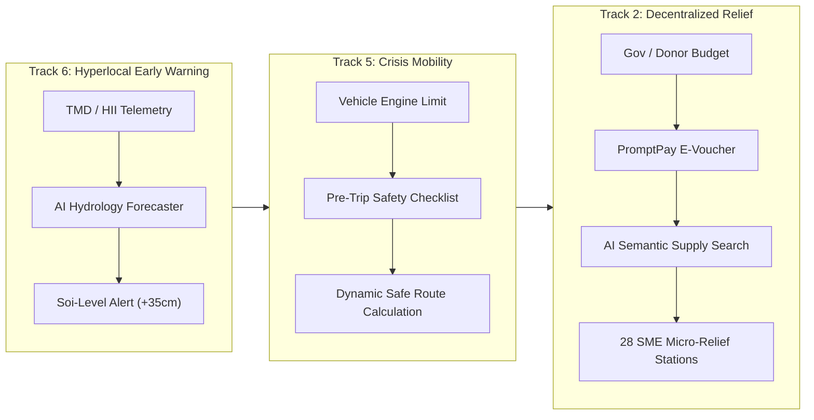

# 🌊 PromptMesh
### Hyperlocal Disaster-to-Commerce (D2C) Mesh

<div align="center">

[](#)
[](#)
[](#)
[](#)
[](#)
[](#)
[](LICENSE)

<br/>

> **"เตือนภัยตรงจุด ➔ เดินทางปลอดภัย ➔ เสบียงหมุนเวียนด้วยเงินท้องถิ่น"**  
> เปลี่ยนวิกฤตอุทกภัยให้เป็นโอกาสในการฟื้นฟูเศรษฐกิจชุมชน ผ่านระบบดิจิทัลวอลเล็ตแบบกระจายศูนย์และแบบจำลอง AI นำทางกู้ภัย

[🚀 Live Demo](#) · [🎭 วิธีทดสอบ 4 บทบาท (Demo Roles)](#-demo-roles-guide-คู่มือการทดสอบ-4-บทบาท) · [📋 คุณสมบัติเด่น](#-key-differentiators-3-wow-factor-features) · [🏗 สถาปัตยกรรม](#-system-architecture)

</div>

---

## 📌 Executive Summary (บทสรุปผู้บริหาร)

**PromptMesh** คือแพลตฟอร์มรับมืออุทกภัยอัจฉริยะระดับชุมชนย่อย (Hyperlocal Crisis Platform) ที่แก้ปัญหาความล้มเหลวของการบรรเทาทุกข์แบบรวมศูนย์ (Centralized Relief Bottlenecks) เช่น ถุงยังชีพล่าช้า สิ่งของไม่ตรงกับความต้องการของผู้ป่วย และร้านค้าโชห่วยในพื้นที่ล้มละลายหลังน้ำท่วม 

PromptMesh เชื่อมโยง **3 กลไกหลัก (3-Track Continuum)** เข้าด้วยกัน:
1. **Track 6 (Early Warning):** พยากรณ์ระดับน้ำท่วมล่วงหน้าระดับ "ซอย" ด้วย AI Hydrology Forecaster 
2. **Track 5 (Smart Mobility):** ระบบนำทางหลบน้ำท่วมลึกตามประเภทยานพาหนะ (เก๋ง, กระบะ 4WD, เรือ) พร้อมจุดตรวจสอบความปลอดภัย
3. **Track 2 (Decentralized Relief):** เปลี่ยนร้านค้า SME โชห่วยในพื้นที่ให้กลายเป็น "สถานีเสบียงย่อย (Micro-Relief Stations)" และอัดฉีดงบประมาณเยียวยาผ่าน **E-Voucher เชื่อมต่อระบบ PromptPay และ Krungthai Open API** ตรงสู่กระเป๋าเงินดิจิทัลของประชาชน เพื่อให้เงินหมุนเวียนฟื้นฟูเศรษฐกิจฐานรากทันที

> **365-Day Crisis-to-Welfare Utility:** ในยามปกติที่ไม่มีน้ำท่วม ระบบจะเปลี่ยนโหมดเป็นแพลตฟอร์มแจกเบี้ยยังชีพและสวัสดิการชุมชนขององค์กรปกครองส่วนท้องถิ่น (อปท. กว่า 7,800 แห่งทั่วประเทศ) ทำให้แพลตฟอร์มมีความพร้อมใช้งานตลอดเวลา ไม่ถูกทิ้งร้าง

---

## 🌟 Key Differentiators: 3 "Wow Factor" Features (จุดเด่นระดับนวัตกรรม)

เพื่อส่งมอบคุณค่าสูงสุดในการนำเสนอผลงาน Hackathon ทางทีมงานได้อัปเกรด 3 ฟีเจอร์ทรงพลังที่สร้างความแตกต่างอย่างเด่นชัด:

```
┌──────────────────────────────────────────────────────────────────────────────────┐
│                             PROMPTMESH MVP PIPELINE                              │
├───────────────────────┬──────────────────────────┬───────────────────────────────┤
│  🎭 Role-Based Auth   │  🧠 AI Semantic Search   │  🚗 Pre-Trip Checklist        │
│  (Multi-Stakeholder)  │  (Track 2 NLP Matcher)   │  (Track 5 Safety Mobility)    │
│  สลับ 4 บทบาทเรียลไทม์│  ค้นหาเสบียงด้วยภาษาพูด  │  ตรวจ 3 จุดวิกฤตรถก่อนลุยน้ำ │
├───────────────────────┼──────────────────────────┼───────────────────────────────┤
│  🚨 SOS Rescue Form   │  🔄 CI/CD Action Pipeline│  📦 SME Stock & CSV Export   │
│  (Flashing Map Pin)   │  (Pending->Dispatched)   │  (Track 2 Local-First)        │
│  ขอความช่วยเหลือฉุกเฉิน │  ติดตามสถานะกู้ภัยสด 3 ขั้น │  ปรับสต็อก & ส่งออก .CSV ทันที│
└───────────────────────┴──────────────────────────┴───────────────────────────────┘
```

### 1. 🎭 Role-Based Authentication & Multi-Stakeholder Crisis Workflows
ระบบล็อกอินจำลองแบบ Full-screen Soft UI (`#login-view`) ที่เปิดโอกาสให้กรรมการและผู้ประเมินสามารถสลับมุมมองการทำงานของผู้มีส่วนได้ส่วนเสีย 4 กลุ่มหลักได้ทันที:
- **ประชาชน (Resident):** ตรวจสอบระดับน้ำเตือนภัยซอยไร่ขิง 26, ตรวจสอบยอดเงินเยียวยา **฿1,500**, และสแกน Dynamic QR รับเสบียง
- **ร้านค้า SME (Merchant):** แสดง **Store Sales Dashboard** จำลองยอดขายคูปองวันนี้ **฿18,450** (42 ธุรกรรม), สรุปรอบเงินโอนเข้าบัญชีร้านค้าผ่าน Krungthai Open API, ตรวจสอบสต็อกเสบียงคงคลัง, และมีระบบ **Merchant POS Scanner** สแกนรับคูปองจากประชาชน
- **ทีมกู้ภัย (Rescue):** หน้าต่างบัญชาการ **Rescue Operations Command** แสดงคิวขอความช่วยเหลือฉุกเฉิน (เช่น ผู้ป่วยติดเตียงต้องการแผ่นรองซับและเรือ), สถานะความพร้อมของฝูงยานพาหนะ (รถ 4x4, เรือท้องแบน), และสิทธิ์ปักหมุดสิ่งกีดขวางระดับ Verified
- **อปท. / ผู้บริจาค (Gov & Donor Portal):** แดชบอร์ดติดตามงบเยียวยา **฿2,500,000** (เบิกจ่ายแล้ว 73.6%), ตรวจสอบความโปร่งใสผ่านบัญชีกลาง, และมี **Interactive Fund Injection Tool** จำลองการกดอัดฉีดงบฉุกเฉินระดับซอย **+฿500,000** เข้าสู่ E-Voucher ประชาชนแบบ Real-time
- **ปุ่มเปลี่ยนบทบาท:** เข้าถึงได้ตลอดเวลาผ่าน Header บนมุมขวา และ Bottom Navigation Bar

### 2. 🧠 AI Semantic Supply Search (Track 2 NLP Upgrade)
ยกระดับการค้นหาเสบียงจากการค้นหาคีย์เวิร์ดธรรมดา สู่ระบบทำความเข้าใจบริบทความต้องการฉุกเฉินด้วยภาษาธรรมชาติ (NLP Intent Parsing):
- **ช่องค้นหาอัจฉริยะ:** ผู้ประสบภัยสามารถพิมพ์ความต้องการในชีวิตจริง เช่น *"ยายป่วย ไฟดับ ต้องการแผ่นรองซับ..."* หรือคลิกปุ่มตัวอย่างด่วน
- **AI Processing Loading Pulse Effect:** แสดงแอนิเมชัน Pulse Effect กระจายแสงแบบ Soft UI พร้อมแถบวิเคราะห์สถานะการประมวลผล NLP
- **Context Extraction & Stock Matching:** ระบบวิเคราะห์ความต้องการ (ผู้ป่วยติดเตียง + ไฟฟ้าดับ) และดึงข้อมูลสต็อกแบบเรียลไทม์จาก 28 ร้านค้า SME
- **ผลลัพธ์บริบท:** แสดงผลลัพธ์ผ่าน Glassmorphism Modal: *"AI วิเคราะห์บริบท: พบร้าน 'ป้าพร โชห่วยซอย 26' มีแผ่นรองซับผู้ใหญ่ 15 แพ็ค และชุดปฐมพยาบาล"* พร้อมระยะทาง 800 ม. และสถานะน้ำท่วม 0 ซม.
- **Interactive Pin Highlight on Google Maps:** เมื่อกดปุ่ม *"ไฮไลต์พิกัดร้านบนแผนที่ & นำทางทันที"* แผนที่จะ Pan & Zoom ไปยังร้านป้าพร หมุดร้านค้าจะเคลื่อนไหวแบบเด้ง (Bounce Animation) พร้อมเปิด InfoWindow แสดงรายละเอียดสินค้า และคำนวณเส้นทางปลอดภัยให้อัตโนมัติ

### 3. 🚗 Vehicle Evacuation Readiness Checklist (Track 5 Safety Feature)
ฟีเจอร์ด้านความปลอดภัยขั้นสูงที่ช่วยลดอุบัติเหตุและป้องกันความสูญเสียจากเครื่องยนต์ดับหรือไฟลัดวงจรขณะขับรถลุยน้ำท่วม:
- **Intelligent Route Interception:** เมื่อผู้ใช้กดปุ่ม **"คำนวณเส้นทางปลอดภัย"** ระบบจะหยุดกระบวนการชั่วคราวและเปิด Glassmorphism Modal `#modal-pre-trip-checklist`
- **3 Critical Checkpoints Checklist:** รายการตรวจสอบ 3 จุดวิกฤตที่ปรับตามประเภทยานพาหนะที่เลือก:
  1. `[✓]` **ตรวจสอบระบบสวิตช์ไฟฉุกเฉิน และรีเลย์ไฟเลี้ยว:** ป้องกันระบบไฟฟ้าช็อต ไฟหน้ารถดับ และรักษาระบบไฟสัญญาณฉุกเฉินเมื่อลุยน้ำ
  2. `[✓]` **เช็กความแน่นหนาของน็อตอ่างน้ำมันเครื่องแบบแม่เหล็ก:** ป้องกันน้ำซึมเข้าห้องเครื่องยนต์และแคร้งค์น้ำมันเครื่องขณะดับเครื่องยนต์กะทันหัน
  3. `[✓]` **ตรวจสอบซีลยางขอบประตูและระดับท่อไอเสีย:** ป้องกันน้ำทะลักเข้าห้องโดยสาร และเลี้ยงรอบเครื่องยนต์ไม่ให้ดับขณะน้ำท่วมมิดท่อ
- **ยืนยันความปลอดภัย & เริ่มนำทาง:** เมื่อผู้ใช้ยืนยันรายการตรวจสอบ ระบบจึงจะเริ่มประมวลผลอัลกอริทึมเส้นทางปลอดภัย (Safe Navigation Routing) พร้อมแอนิเมชันสแกนแนวสันดอนหลบน้ำบนแผนที่

### 4. 🚨 Rapid SOS Rescue Request & Flashing Map Sync (Track 5)
ระบบแจ้งขอความช่วยเหลือฉุกเฉินระดับบุคคล (`#modal-sos-request`) ที่เชื่อมต่อระหว่างประชาชนและหน่วยกู้ภัยในพื้นที่:
- **ปุ่มด่วน SOS ฉุกเฉิน:** ปุ่มสีแดงเด่นบน Dashboard ประชาชน (`.sos-trigger-btn`) เข้าถึงง่ายในเวลาวิกฤต
- **ฟอร์มระบุความต้องการเฉพาะหน้า:** ระบุชื่อ, เบอร์โทรศัพท์ฉุกเฉิน, Checkbox ความต้องการเร่งด่วน (ผู้ป่วยติดเตียง, ต้องการเรือท้องแบน, แผ่นรองซับผู้ใหญ่, เสบียงอาหาร), พิกัด และรายละเอียดเพิ่มเติม
- **Flashing Red Map Marker:** เมื่อกดส่งคำขอ ระบบจะสร้างตั๋วฉุกเฉิน (เช่น `#SOS-NKP-881`) และปักหมุดสีแดงกระพริบ (Pulsing SVG Marker) ซิงก์บน Google Maps ให้เห็นจุดติดเกาะทันที พร้อม InfoWindow ข้อมูลติดต่อ

### 5. 🔄 CI/CD Style Action Status Pipeline (Track 5)
นวัตกรรมการติดตามสถานะการกู้ภัยที่นำคอนเซปต์ **CI/CD Pipeline (Continuous Integration / Continuous Delivery)** จากวงการวิศวกรรมซอฟต์แวร์ มาประยุกต์ใช้กับการช่วยเหลือผู้ประสบภัย:
- **3-Stage Visual Pipeline:**
  1. `🔴 รอรับเรื่อง (Pending):` คำขอถูกส่งผ่านเครือข่าย LoRa Mesh เข้าสู่คิวส่วนกลาง
  2. `🟡 กำลังเดินทาง (Dispatched):` หน่วยกู้ภัยกดรับเคส พร้อมนำเรือท้องแบนและเสบียงมุ่งหน้าสู่พื้นที่
  3. `🟢 ช่วยเหลือสำเร็จ (Resolved):` ส่งมอบเสบียงและอพยพผู้ป่วยสู่จุดปลอดภัยสำเร็จ
- **Two-Way Realtime Sync:** เมื่อฝั่งกู้ภัยกดปุ่ม **"🚤 รับเคสช่วยเหลือ (Accept)"** หมุดบนแผนที่จะเปลี่ยนจาก **สีแดง ➔ สีเหลือง** ทันที และแถบ Pipeline ของประชาชนจะเปลี่ยนสถานะเป็นขั้นที่ 2 แบบอัตโนมัติ

### 6. 📦 SME Inventory Management & Instant CSV Stock Export (Track 2)
ระบบบริหารจัดการสต็อกเสบียงฉุกเฉินในฝั่งร้านค้าโชห่วยชุมชน (Micro-Relief Station):
- **Interactive Stock Counters:** ปุ่มปรับยอด `+` / `-` สำหรับ 4 เสบียงยังชีพหลัก: น้ำดื่ม 1.5L, ข้าวสาร 5กก., ยาสามัญ, และแผ่นรองซับผู้ใหญ่ พร้อมแจ้งเตือนเมื่อสต็อกต่ำกว่าเกณฑ์ปลอดภัย
- **📥 Instant CSV Exporter:** ปุ่มส่งออกข้อมูลสต็อกด้วยเทคโนโลยี HTML5 `Blob` และ `URL.createObjectURL` ดาวน์โหลดไฟล์ `PromptMesh_Stock_Report.csv` ได้ทันทีแบบ Offline
- **Excel Thai Encoding Ready:** ฝัง **UTF-8 BOM (`\uFEFF`)** ในไฟล์ CSV เพื่อให้เปิดอ่านภาษาไทยบน Microsoft Excel ได้อย่างถูกต้อง 100% โดยไม่มีปัญหาฟอนต์เพี้ยนหรือต่างด้าว

---

## 🎭 Demo Roles Guide (คู่มือการทดสอบ 4 บทบาท)

ในการสาธิตหรือทดสอบการใช้งาน ผู้ประเมินสามารถทดลองสลับบทบาทเพื่อสัมผัสประสบการณ์ของแต่ละ Stakeholder ได้ดังนี้:

| บทบาท (Role) | จุดมุ่งหมายในการทดสอบ (Demo Objective) | ขั้นตอนการทดสอบแนะนำ |
| :--- | :--- | :--- |
| **1. ประชาชน (Resident)** | สัมผัสประสบการณ์ผู้ประสบภัยในพื้นที่เสี่ยง | 1. เลือกบทบาท **"ประชาชน"** ในหน้าแรก<br>2. ตรวจสอบแถบเตือนภัย AI Warning (+35 ซม.) และยอดเงิน E-Voucher **฿1,500**<br>3. กดปุ่มสีแดง **"🚨 SOS ขอความช่วยเหลือด่วน"** ➔ ติ๊กเลือก *ผู้ป่วยติดเตียง / ต้องการเรือท้องแบน* ➔ กด **"ยืนยันส่งสัญญาณฉุกเฉิน"**<br>4. สังเกตแถบ **CI/CD Pipeline** ขึ้นสถานะ `🔴 รอรับเรื่อง (Pending)`<br>5. ทดสอบค้นหาเสบียง AI Semantic Search *"ยายป่วย ไฟดับ ต้องการแผ่นรองซับ"* แล้วดูผลลัพธ์บนแผนที่<br>6. กดปุ่มคำนวณเส้นทางเพื่อทดสอบ **Pre-Trip Checklist** |
| **2. ร้านค้า SME (Merchant)** | สัมผัสบทบาทสถานีเสบียงชุมชนและการจัดการสต็อก | 1. คลิกปุ่ม **"เปลี่ยนบทบาท"** ที่มุมขวาบน แล้วเลือก **"ร้านค้า SME"**<br>2. ตรวจสอบ **Store Sales Dashboard** ยอดรับชำระ **฿18,450** และรอบโอนเข้าพร้อมเพย์<br>3. เลื่อนลงมาที่แผง **ระบบจัดการสต็อกเสบียงชุมชน** ➔ ทดสอบกดปุ่ม `+` / `-` เพื่อปรับยอดน้ำดื่มและแผ่นรองซับ<br>4. กดปุ่ม **"📥 Export Stock (.CSV)"** ระบบจะดาวน์โหลดไฟล์ `PromptMesh_Stock_Report.csv` ที่เปิดใน Excel ได้ทันที<br>5. ทดสอบปุ่ม **"สแกน QR คูปอง (POS Mode)"** เพื่อจำลองการตัดยอดสิทธิ์ |
| **3. ทีมกู้ภัย (Rescue)** | สัมผัสศูนย์ปฏิบัติการกู้ภัยและการขับเคลื่อน CI/CD | 1. สลับบทบาทเป็น **"ทีมกู้ภัย"**<br>2. ในส่วน **Active SOS Queue** จะพบตั๋วฉุกเฉิน `#SOS-NKP-881` ที่ประชาชนเพิ่งส่งเข้ามา<br>3. กดปุ่ม **"🗺️ แผนที่"** เพื่อดูหมุดสีแดงกระพริบกลางน้ำท่วม<br>4. กดปุ่ม **"🚤 รับเคสช่วยเหลือ (Accept)"** ➔ หมุดจะเปลี่ยนเป็น **สีเหลือง** ทันที<br>5. สลับกลับไปบทบาท **ประชาชน** ➔ สังเกตว่า CI/CD Pipeline เลื่อนเป็น `🟡 กำลังเดินทาง (Dispatched)` อัตโนมัติ!<br>6. กลับมาหน้ากู้ภัยแล้วกด **"✅ ช่วยเหลือสำเร็จ (Complete)"** ➔ หมุดเปลี่ยนเป็น **สีเขียว** และเคสถูกบันทึกสมบูรณ์ |
| **4. อปท. (Gov/Donor)** | สัมผัสระบบบริหารงบประมาณและความโปร่งใส | 1. สลับบทบาทเป็น **"อปท. (Gov/Donor)"**<br>2. ตรวจสอบสถานะงบประมาณเยียวยา **฿2,500,000** (เบิกจ่ายแล้ว 73.6% สู่ 28 ร้านค้า)<br>3. ทดสอบเครื่องมือ **Interactive Fund Injection** โดยกดปุ่ม **"อัดฉีดงบฉุกเฉิน +฿500,000 ผ่าน Krungthai API"**<br>4. สังเกตยอดเบิกจ่ายที่อัปเดตแบบ Real-time พร้อมการแจ้งเตือนความโปร่งใสผ่าน PromptPay Ledger |

---

## 🌊 3-Track Innovation Pipeline



### 🌊 Track 6: Hyperlocal Early Warning (เตือนภัยตรงจุด)
- **AI 3-6 Hour Forecaster:** พยากรณ์ระดับน้ำล่วงหน้าเจาะจงระดับ "ซอย" (ซอยไร่ขิง 26 คาดการณ์ +35 ซม.)
- **Isolation Risk Alert:** ตรวจจับพื้นที่ที่เส้นทางคมนาคมกำลังจะถูกตัดขาด เพื่อแจ้งเตือนให้อพยพก่อนน้ำท่วมสูง
- **Dynamic Timeline Slider:** แถบเลื่อนจำลองระดับน้ำบนแผนที่ +1 ชม., +3 ชม., และ +6 ชม. แบบ Real-time

### 🚙 Track 5: Smart Mobility & Crisis Routing (เดินทางปลอดภัย)
- **Vehicle-Aware Routing:** คำนวณเส้นทางเลี่ยงมวลน้ำลึกตามขีดจำกัดยานพาหนะ:
  - 🚗 รถยนต์นั่งส่วนบุคคล (Sedan): ลุยน้ำได้ ≤ 15 ซม. (ระบบจะพาอ้อมแนวคันกั้นน้ำยกสูง)
  - 🛻 รถกระบะยกสูง 4WD (Pickup): ลุยน้ำได้ ≤ 40 ซม. (วิ่งลุยน้ำตื้นเพื่อประหยัดเวลา)
  - 🚤 เรือท้องแบนกู้ภัย (Rescue Boat): ต้องการระดับน้ำ > 30 ซม. (วิ่งตามแนวลำน้ำท่าจีน)
- **Pre-Trip Safety Checklist:** รายการตรวจเช็กความพร้อม 3 จุดสำคัญก่อนออกเดินทางลุยน้ำ
- **Animated Safe Routing:** แสดงเส้นทางโค้งหลบจุดน้ำท่วมด้วยแอนิเมชันแสงวิ่งบน Google Maps

### 🛒 Track 2: Decentralized Relief (เสบียงหมุนเวียนด้วยเงินท้องถิ่น)
- **Micro-Relief Station Network:** เปลี่ยนร้านโชห่วยในชุมชนให้เป็นจุดแจกจ่ายเสบียงใกล้บ้าน
- **AI Semantic Supply Search:** ค้นหาเสบียงด้วยภาษาพูด พร้อมจับคู่สต็อกสินค้าจำเป็นแบบ Real-time
- **E-Voucher via Krungthai Open API:** แจกคูปองดิจิทัล **฿1,500** แยกประเภทอาหาร/น้ำดื่ม และยารักษาโรค
- **Geo-targeted Fund Injection:** แดชบอร์ดให้ อปท. หรือผู้บริจาคอัดฉีดเงินช่วยเหลือลงพื้นที่เป้าหมายได้โดยตรง

---

## 🏗 System Architecture (สถาปัตยกรรม 4 ชั้น Offline-First)

PromptMesh ได้รับการออกแบบภายใต้สถาปัตยกรรม **4-Layer Offline-First Graceful Degradation** เพื่อให้มั่นใจว่าประชาชนจะยังเข้าถึงความช่วยเหลือได้แม้ระบบสื่อสารหลักล่ม:

| ระดับความยืดหยุ่น (Tier) | เทคโนโลยีหลัก (Core Tech) | ขีดความสามารถเมื่อเกิดวิกฤต (Crisis Capability) |
| :--- | :--- | :--- |
| **Layer 1: PWA Edge** | CacheStorage, IndexedDB (< 50MB) | โหลดแผนที่รัศมี 15 กม., เก็บออฟไลน์โทเคนคูปอง E-Voucher แลกรับได้ 100% แม้เน็ตหลุด |
| **Layer 2: Telecom Fallback** | SMS Gateway, USSD PromptPay | ส่ง SMS แจ้งเตือนมวลน้ำระดับซอย, กดรหัส USSD แลกรับสินค้าผ่านฟีเจอร์โฟนรุ่นเก่า |
| **Layer 3: Community Edge Node** | AWS IoT Greengrass + LoRaWAN | โหนดเซนเซอร์ระดับน้ำประจำ อบต. ประมวลผลและส่งสัญญาณเตือนภัยโดยไม่ต้องพึ่งพาคลาวด์ภายนอก |
| **Layer 4: Mesh Relay** | Wi-Fi Direct + อสม. (Human Mesh) | เครือข่ายเสียงตามสายหมู่บ้าน และอาสาสมัครสาธารณสุขประจำหมู่บ้านนำส่งรหัสคูปอง |

---

## 🎨 Crisis Usability & Design System Guidelines

ระบบถูกออกแบบภายใต้ปรัชญา **Crisis Usability** เพื่อลดความตระหนกและลดภาระทางสายตาของผู้ประสบภัย:
- **Style:** Soft UI (Apple OS Style) เส้นสายโค้งมน มิติเงาละมุน (Diffused Box Shadows)
- **Color Palette:** Pure White (`#ffffff`), Solid Blue (`#2563eb`), และ Semantic State Colors (ห้ามใช้การไล่เฉดสีรบกวนสายตา)
- **Typography:** แบบอักษร `Kanit` 100% ทุกส่วนแสดงผลคมชัด อ่านง่ายแม้อยู่กลางแจ้ง
- **Glassmorphism:** แผ่นควบคุมลอยตัว (`backdrop-filter: blur(14px)`) เหนือ Google Maps
- **Zero Emojis Policy in Code:** ใช้ Vector Icons (SVG) เพื่อความเข้ากันได้ 100% บนทุกเบราว์เซอร์

---

## 🚀 Getting Started (การติดตั้งและรันระบบทดสอบ)

### สิ่งที่ต้องเตรียม (Prerequisites)
- เว็บบราวเซอร์สมัยใหม่ (Google Chrome, Safari, Microsoft Edge, Firefox)
- Node.js (v18+) หรือ Python 3.8+ (สำหรับรัน HTTP Local Server)

### วิธีการรันโปรเจกต์
1. Clone Repository นี้ลงในเครื่องของคุณ:
   ```bash
   git clone https://github.com/your-username/promptmesh.git
   cd promptmesh
   ```

2. รันแอปพลิเคชันผ่าน Local HTTP Server:
   - **ทางเลือกที่ 1 (Python Server):**
     ```bash
     python -m http.server 5500
     ```
   - **ทางเลือกที่ 2 (Node.js npx serve):**
     ```bash
     npx serve -l 5500
     ```
   - **ทางเลือกที่ 3 (VS Code Live Server):**
     คลิกขวาที่ไฟล์ `index.html` แล้วเลือก *"Open with Live Server"*

3. เปิดเบราว์เซอร์และเข้าไปที่:
   ```
   http://localhost:5500/index.html
   ```

---

## 🗺 12-Month Pilot Roadmap

- [x] **Phase 0:** Concept Design & Crisis Usability Architecture (เสร็จสมบูรณ์)
- [x] **Phase 1a:** Interactive UI/UX MVP + Google Maps API + 3 Hackathon Features (เสร็จสมบูรณ์)
- [ ] **Phase 1b:** เชื่อมต่อแบบจำลองน้ำท่วม AI กับคลังข้อมูลโทรมาตร สสน. (HII) และกรมอุตุนิยมวิทยา (TMD)
- [ ] **Phase 2:** นำร่องภาคสนาม (Field Sandbox) ณ อำเภอสามพราน จังหวัดนครปฐม (500 ครัวเรือน, 50 ร้านค้า SME)
- [ ] **Phase 3:** ขยายผลสู่โหมดสวัสดิการชุมชน 365 วัน ร่วมกับ อปท. ภาคกลาง

---

## 👥 Core Team & Hackathon Information

โครงการนี้พัฒนาขึ้นสำหรับการแข่งขัน **AI for All Thailand Innovation Sprint 2026**  
**Pillar:** Resilient Communities (นวัตกรรมชุมชนพร้อมรับวิกฤต)  
**Track:** Track 2 (Decentralized Relief), Track 5 (Crisis Mobility), Track 6 (Hyperlocal Warning)

---

## 📄 License
This project is open-source under the [MIT License](LICENSE).

<div align="center">
  <br/>
  <b>PromptMesh: Empowering Communities Through Hyperlocal Tech & Local Economy.</b>
</div>
